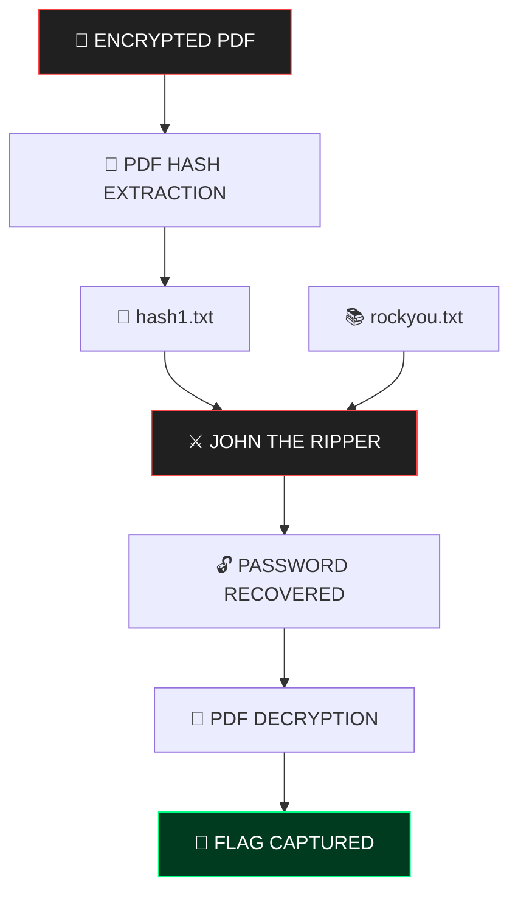

# 🔐 PASSWORD CRACKING & HASH ANALYSIS
### `JOHN THE RIPPER` | PDF PASSWORD RECOVERY LAB

<div align="center">

```text
╔══════════════════════════════════════════════════════════╗
║                                                          ║
║        ██████╗  ██████╗  ██████╗ ███████╗                ║
║        ██╔══██╗██╔═══██╗██╔══██╗██╔════╝                ║
║        ██████╔╝██║   ██║██████╔╝█████╗                  ║
║        ██╔═══╝ ██║   ██║██╔══██╗██╔══╝                  ║
║        ██║     ╚██████╔╝██║  ██║███████╗                ║
║        ╚═╝      ╚═════╝ ╚═╝  ╚═╝╚══════╝                ║
║                                                          ║
║             [ PASSWORD AUDIT INITIATED ]                 ║
╚══════════════════════════════════════════════════════════╝
```

**WEEK 03 | PROJECT MODULE 01**

`CYBERSECURITY` • `ETHICAL HACKING` • `PASSWORD SECURITY`


**A Hands-On Cybersecurity Lab by NETWORKWALKS**

</div>

---

## `01` // MISSION BRIEFING

> **OBJECTIVE:** Extract a cryptographic password hash from an encrypted PDF, perform an offline dictionary attack using John the Ripper on Kali Linux, recover the plaintext password, and unlock the document to capture the hidden flag.

**Target File:** `My Locked PDF1.pdf`

**Mission Status:** `COMPLETED`

### ⚡ Attack Overview



---

## `02` // LAB ENVIRONMENT

| Component | Configuration |
|:---|:---|
| Operating System | Kali Linux |
| Password Cracking Tool | John the Ripper |
| Hash Extraction Utility | pdf2john |
| Wordlist | rockyou.txt |
| Attack Technique | Dictionary Attack |
| Target | Encrypted PDF Document |
| Training Organization | NETWORKWALKS |

---

## `03` // OPERATION EXECUTION

### `[ STEP 01 ]` Extract PDF Password Hash

Extract the encryption hash from the target PDF using `pdf2john`.

```bash
pdf2john "My Locked PDF1.pdf" > hash1.txt
```

**Output:** Extracted hash successfully saved in `hash1.txt`.

### `[ STEP 02 ]` Prepare the Wordlist

Decompress the built-in RockYou wordlist.

```bash
sudo gzip -d /usr/share/wordlists/rockyou.txt.gz
```

**Wordlist Location:**

```text
/usr/share/wordlists/rockyou.txt
```

### `[ STEP 03 ]` Launch Dictionary Attack

Execute John the Ripper against the extracted PDF hash.

```bash
john --wordlist=/usr/share/wordlists/rockyou.txt hash1.txt
```

**Attack Method:** Offline Dictionary-Based Password Cracking.

### `[ STEP 04 ]` Retrieve the Recovered Password

Display the recovered credentials from John's password database.

```bash
john --show hash1.txt
```

**Result:** Password recovery successfully verified.

### `[ STEP 05 ]` Decrypt PDF & Capture Flag

Open `My Locked PDF1.pdf` and enter the recovered password.

<div align="center">

```text
┌─────────────────────────────────────────────────────┐
│                                                     │
│             [ ACCESS GRANTED ]                      │
│                                                     │
│          ✓ PASSWORD SUCCESSFULLY RECOVERED         │
│          ✓ ENCRYPTED PDF UNLOCKED                   │
│          ✓ FIRST FLAG CAPTURED                      │
│                                                     │
│             MISSION STATUS: COMPLETE               │
│                                                     │
└─────────────────────────────────────────────────────┘
```

**🏁 FLAG CAPTURED SUCCESSFULLY!**

</div>

---

## `04` // DIGITAL EVIDENCE

**Proof of Execution**

The following screenshots document the practical execution and successful completion of this lab.

<div align="center">

| TERMINAL — PASSWORD CRACKING | PDF — FLAG CAPTURED |
|:---:|:---:|
|  |  |
| `jtr-cracked.png` | `unlocked-pdf.png` |

</div>

> 📌 Place your original screenshots inside the repository's `screenshots/` directory. Keep the filenames exactly as shown above.

---

## `05` // SECURITY INTELLIGENCE

### 🔍 Key Technical Learnings

**01. Encryption vs. Hashing**

Encryption is reversible using the appropriate decryption key, whereas cryptographic hashing is designed as a one-way process. PDF password protection uses encryption, and tools such as `pdf2john` extract the relevant password-verification data for auditing.

**02. Weak Password Vulnerability**

Weak and predictable passwords can be recovered through offline dictionary attacks, particularly when commonly used passwords appear in the wordlist.

**03. Dictionary Attack Methodology**

A dictionary attack systematically tests candidate passwords against an extracted hash rather than attempting every possible character combination.

**04. Defensive Recommendations**

- Use long, unique and high-entropy passwords.
- Use a trusted password manager.
- Avoid common words and predictable password patterns.
- Use strong encryption settings when protecting sensitive documents.
- Enable MFA on accounts where supported.

---

## `06` // REPOSITORY STRUCTURE

```text
Password-Cracking-John-The-Ripper/
│
├── 📄 README.md
│
├── 📂 screenshots/
│   ├── jtr-cracked.png
│   └── unlocked-pdf.png
│
├── 📄 hash1.txt
│
└── 📄 My Locked PDF1.pdf
```

**Note:** Do not upload sensitive password hashes, recovered passwords, or protected original documents to a public repository. Keep sensitive lab evidence private or sanitize it before sharing.

---

## `07` // ETHICAL DISCLAIMER

> **AUTHORIZED EDUCATIONAL USE ONLY**

This project was performed strictly for educational and defensive cybersecurity learning purposes as part of the hands-on training program provided by **NETWORKWALKS**.

All testing was conducted in an authorized lab environment.

Password auditing and cracking techniques must never be used against files, accounts, or systems without explicit permission from their owners.

---

<div align="center">

```text
╔════════════════════════════════════════════════════════╗
║                                                        ║
║             [ MISSION ACCOMPLISHED ]                   ║
║                                                        ║
║       LEARN • ANALYZE • TEST • SECURE                  ║
║                                                        ║
╚════════════════════════════════════════════════════════╝
```

**⭐ If you found this project useful, consider giving this repository a star!**

`NETWORKWALKS` | `CYBERSECURITY TRAINING` | `WEEK 03`

</div>
