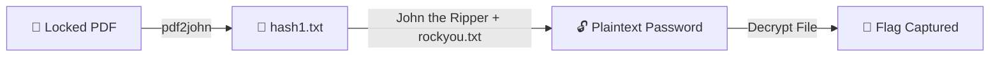

<div align="center">

  <h1>🔐 Password Cracking & Hash Analysis with John the Ripper</h1>
  <p><b>Week 3 – Project Module 1 | Cybersecurity & Ethical Hacking Hands-On Lab</b></p>

  <!-- Badges -->
  <p>
    
    
    
    
  </p>

  <p>
    <i>Completed as part of the hands-on cybersecurity training program by <b>Networkwalks</b>.</i>
  </p>

</div>

---

## 📌 Project Overview

> **Objective:** Extract the cryptographic password hash from an encrypted PDF file (`My Locked PDF1.pdf`), execute an offline dictionary attack using **John the Ripper (JTR)** on **Kali Linux**, and recover the plaintext password to capture the hidden flag.

### 🔄 Attack Workflow



---

## 🛠️ Tech Stack & Lab Environment

| Component | Details | Purpose |
| :--- | :--- | :--- |
| **Operating System** | Kali Linux | Penetration testing & security auditing environment |
| **Cracking Engine** | John the Ripper (JTR) | Offline password hash cracking utility |
| **Hash Extractor** | `pdf2john` | Converts PDF encryption metadata into a crackable hash |
| **Wordlist** | `rockyou.txt` | Industry-standard wordlist for dictionary-based attacks |

---

## 🚀 Step-by-Step Execution

### 1️⃣ Extract Hash from the Encrypted PDF
Use `pdf2john` to extract the password hash from the target PDF and store it in `hash1.txt`:
```bash
pdf2john "My Locked PDF1.pdf" > hash1.txt
```

### 2️⃣ Decompress the Wordlist
Unzip Kali Linux's built-in `rockyou.txt` wordlist before running the dictionary attack:
```bash
sudo gzip -d /usr/share/wordlists/rockyou.txt.gz
```

### 3️⃣ Run Dictionary Attack with John the Ripper
Launch JTR against the extracted hash using `rockyou.txt`:
```bash
john --wordlist=/usr/share/wordlists/rockyou.txt hash1.txt
```

### 4️⃣ Reveal the Cracked Password
Display the recovered plaintext password from John's pot file:
```bash
john --show hash1.txt
```

### 5️⃣ Unlock the PDF & Verify the Flag
Enter the cracked password into `My Locked PDF1.pdf` to decrypt the document and retrieve the confirmation message:
> 🎉 **`Congratulations! You have captured your 1st flag`**

---

## 📸 Proof of Work (Screenshots)

*(Upload your images inside a `screenshots/` folder in your repository to display them in this table)*

| Terminal Hash Cracking | Decrypted PDF & Flag |
| :---: | :---: |
|  |  |

---

## 💡 Key Security Takeaways

- **Encryption vs. Hashing:** Encryption protects file data (two-way), whereas password verification relies on cryptographic hashes (one-way).
- **Vulnerability of Weak Passwords:** Even encrypted files can be compromised rapidly offline if protected with common or predictable passwords.
- **Defense Recommendations:** Always enforce high-entropy passwords (12+ mixed characters), use password managers, and enable Multi-Factor Authentication (MFA) where applicable.

---

## ⚠️ Ethical Disclaimer

> **Note:** This project was performed strictly for educational and defensive learning purposes inside an authorized lab environment provided by **Networkwalks**. Never attempt password cracking on files or systems without explicit permission.

---

<div align="center">
  <b>⭐ If you found this project helpful, feel free to star this repository!</b>
</div>
